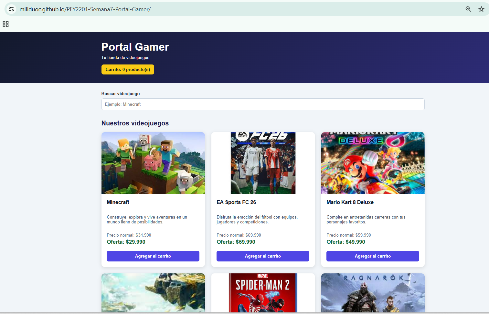
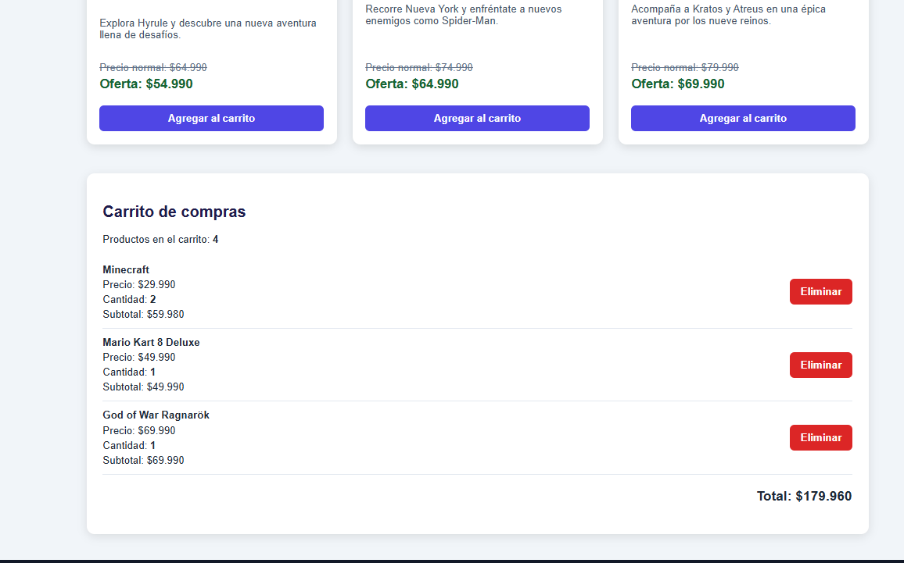
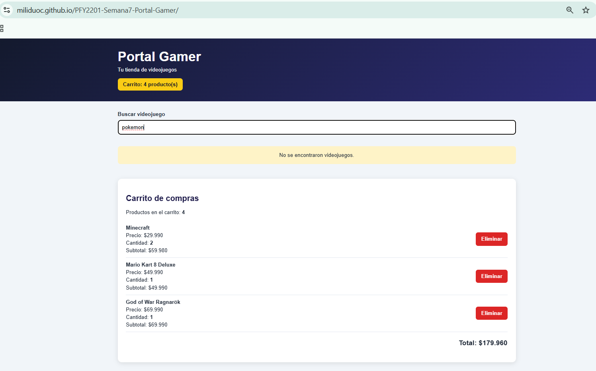
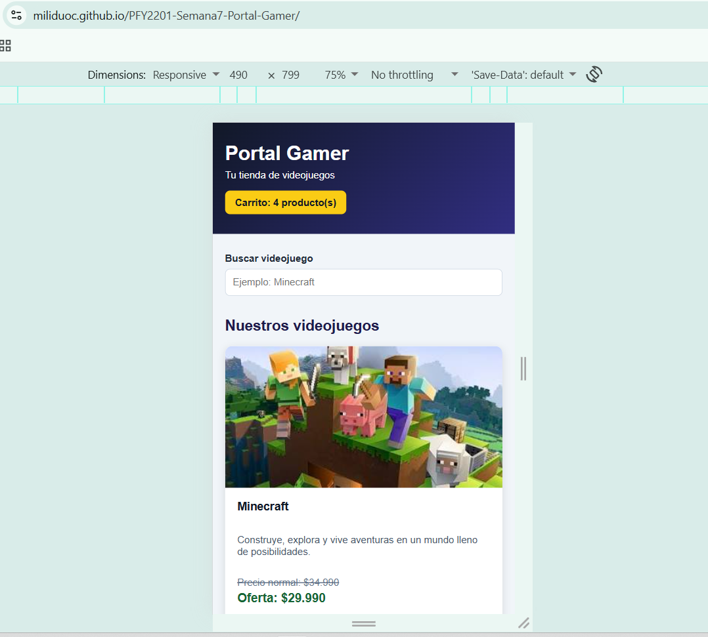

# Portal Gamer - Formativa Semana 7

Proyecto desarrollado para la asignatura **Desarrollo Frontend I (PFY2201)**.

## Objetivo

Continuar el desarrollo del eCommerce Portal Gamer utilizando React, incorporando componentes funcionales, manejo de estado con Hooks, eventos de usuario, renderizado condicional y un carrito de compras interactivo.

## Tecnologías utilizadas

- React
- Vite
- JavaScript
- JSX
- CSS3
- React Hooks (`useState`)
- Git y GitHub
- GitHub Pages

## Funcionalidades implementadas

### Catálogo de productos

El sitio presenta un catálogo de videojuegos mediante componentes de React.

Cada producto muestra:

- Imagen
- Nombre
- Descripción
- Precio normal
- Precio de oferta
- Botón para agregar al carrito

Los datos de los productos se encuentran organizados en `src/data/productos.js`.

### Componentes React

La aplicación fue organizada utilizando componentes funcionales reutilizables:

- `App.jsx`: componente principal y manejo general del estado.
- `ListaProductos.jsx`: genera el listado de videojuegos.
- `ProductoCard.jsx`: representa individualmente cada producto.
- `Carrito.jsx`: muestra y administra el resumen del carrito.

Esta estructura permite mantener el código organizado, modular y reutilizable.

## Manejo de estado con useState

Se utiliza el Hook `useState` para controlar:

- Los productos agregados al carrito.
- El texto ingresado en el buscador.

Cuando un usuario agrega varias veces el mismo videojuego, se actualiza su cantidad sin duplicar innecesariamente el producto dentro del resumen del carrito.

## Carrito de compras

El carrito permite:

- Agregar productos.
- Aumentar la cantidad de un producto cuando se agrega nuevamente.
- Eliminar productos.
- Mostrar la cantidad de cada videojuego.
- Calcular el subtotal de cada producto.
- Mostrar la cantidad total de unidades agregadas.
- Calcular automáticamente el total de la compra.

## Buscador de videojuegos

El buscador utiliza el evento `onChange` para actualizar el estado mientras el usuario escribe.

Los productos se filtran dinámicamente según el nombre ingresado.

Si no existen coincidencias, se muestra el mensaje:

> No se encontraron videojuegos.

## Eventos

La aplicación utiliza eventos de React para generar interacción con el usuario.

Entre ellos:

- `onClick` para agregar productos al carrito.
- `onClick` para eliminar productos del carrito.
- `onChange` para realizar búsquedas.

## Renderizado condicional

Se implementó renderizado condicional para mostrar distintos contenidos según el estado de la aplicación.

Ejemplos:

- Mensaje cuando el carrito está vacío.
- Listado y total cuando existen productos en el carrito.
- Mensaje cuando una búsqueda no encuentra videojuegos.

## Diseño responsivo

La interfaz se adapta a diferentes tamaños de pantalla mediante CSS y Media Queries.

El catálogo presenta:

- Tres columnas en pantallas grandes.
- Dos columnas en pantallas medianas.
- Una columna en dispositivos móviles.

## Estructura principal del proyecto

```text
semana7-react/
├── public/
│   └── img/
├── src/
│   ├── components/
│   │   ├── Carrito.jsx
│   │   ├── ListaProductos.jsx
│   │   └── ProductoCard.jsx
│   ├── data/
│   │   └── productos.js
│   ├── App.css
│   ├── App.jsx
│   ├── index.css
│   └── main.jsx
├── index.html
├── package.json
└── vite.config.js
```

## Ejecución local

Para ejecutar el proyecto:

```bash
cd semana7-react
npm install
npm run dev
```

Para generar la versión de producción:

```bash
npm run build
```

## Despliegue

El proyecto utiliza `gh-pages` para generar y publicar la versión de producción de React en la rama `gh-pages`.

## Evidencias de funcionamiento

### Catálogo de productos



### Carrito de compras



### Búsqueda sin resultados



### Diseño responsive



## Sitio publicado

Repositorio GitHub:

https://github.com/MiliDuoc/PFY2201-Semana7-Portal-Gamer

GitHub Pages:

https://miliduoc.github.io/PFY2201-Semana7-Portal-Gamer/