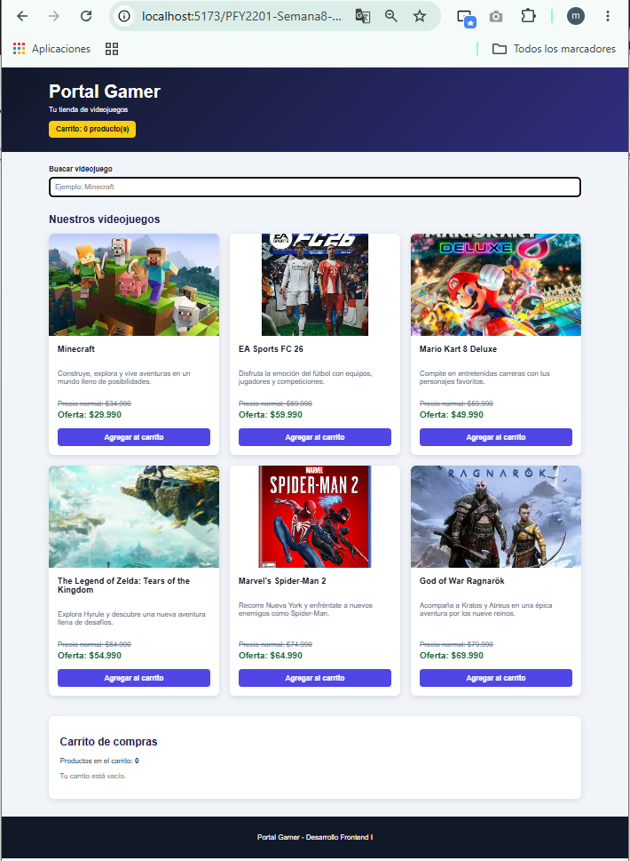
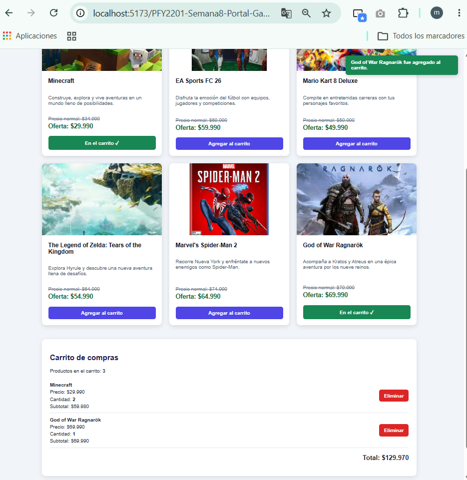
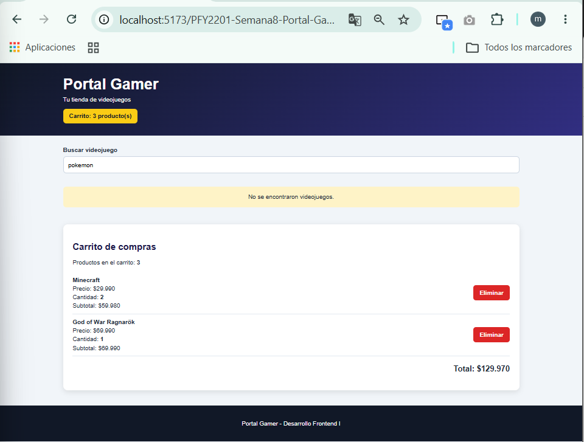
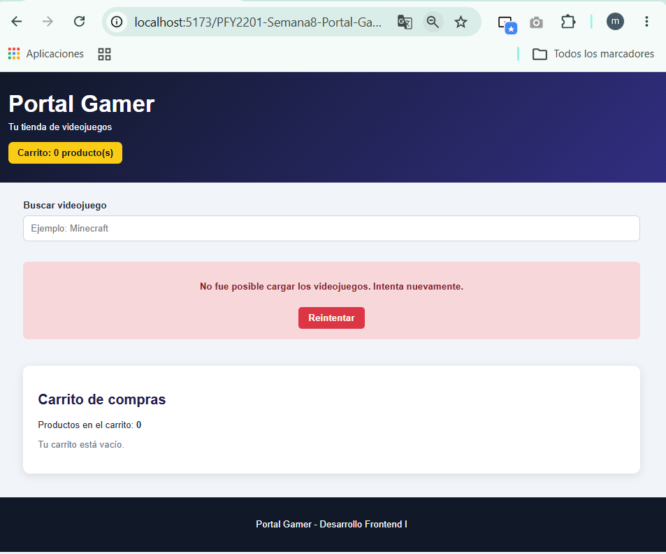

# Portal Gamer - Semana 8

Proyecto desarrollado para la asignatura **Desarrollo Frontend I (PFY2201)**.

## Actividad

**Semana 8 - Evaluación Sumativa**

**Mejorando funcionalidades clave en el eCommerce con React**

El proyecto continúa el eCommerce desarrollado durante las semanas anteriores y aplica mejoras relacionadas con gestión de estados, efectos secundarios, renderizado condicional y experiencia de usuario.

---

## Objetivo

Optimizar la aplicación Portal Gamer utilizando componentes funcionales de React, Hooks como `useState` y `useEffect`, carga dinámica de información y renderizado condicional.

---

## Tecnologías utilizadas

- React
- Vite
- JavaScript
- JSX
- CSS3
- React Hooks:
  - `useState`
  - `useEffect`
- Fetch API
- Web Storage API (`localStorage`)
- Git
- GitHub
- GitHub Pages

---

## Funcionalidades implementadas

### Catálogo de videojuegos

Los productos se cargan dinámicamente desde el archivo:

```text
public/productos.json
```

La aplicación utiliza `fetch` dentro de `useEffect` para obtener la información y actualizar el estado del catálogo.

Cada videojuego contiene:

- Imagen
- Nombre
- Descripción
- Precio normal
- Precio de oferta
- Botón para agregar al carrito

---

## Gestión de estados con `useState`

Se utiliza `useState` para gestionar distintos elementos interactivos de la aplicación:

- Lista de productos.
- Carrito de compras.
- Buscador.
- Estado de carga.
- Estado de error.
- Mensajes de notificación.

---

## Manejo de efectos con `useEffect`

La aplicación utiliza `useEffect` para:

- Cargar dinámicamente los productos desde un archivo JSON.
- Guardar automáticamente el carrito en `localStorage`.
- Ocultar automáticamente las notificaciones después de unos segundos.

---

## Carrito de compras

El carrito permite:

- Agregar productos.
- Incrementar la cantidad cuando se agrega nuevamente un mismo producto.
- Eliminar productos.
- Solicitar confirmación antes de eliminar.
- Calcular subtotales.
- Calcular la cantidad total de productos.
- Calcular el total monetario del carrito.
- Conservar los productos después de recargar la página mediante `localStorage`.

---

## Renderizado condicional

La aplicación utiliza renderizado condicional para mostrar diferentes elementos según el estado.

### Producto agregado

Cuando un videojuego se encuentra en el carrito, el botón cambia de:

```text
Agregar al carrito
```

a:

```text
En el carrito ✓
```

Además, cambia visualmente de color.

### Carrito vacío

Cuando no existen productos seleccionados se muestra:

```text
Tu carrito está vacío.
```

### Búsqueda sin resultados

Cuando la búsqueda no encuentra coincidencias se muestra:

```text
No se encontraron videojuegos.
```

### Estado de carga

Mientras se obtienen los productos se muestra:

```text
Cargando videojuegos...
```

### Estado de error

Si ocurre un problema al cargar los productos se muestra:

```text
No fue posible cargar los videojuegos. Intenta nuevamente.
```

También se incorpora un botón **Reintentar**, que permite volver a solicitar los datos sin recargar manualmente la página.

---

## Notificaciones y experiencia de usuario

Se incorporaron mejoras a partir de la retroalimentación de la Semana 7.

### Notificación al agregar

Al agregar un videojuego aparece una notificación visual temporal indicando que el producto fue agregado correctamente.

### Confirmación de eliminación

Antes de eliminar un producto se solicita confirmación para evitar eliminaciones accidentales.

Después de eliminarlo también aparece una notificación informando la acción realizada.

---

## Buscador

El buscador utiliza el evento `onChange` para actualizar el estado en tiempo real y filtrar los videojuegos por nombre.

---

## Componentes

La aplicación mantiene una estructura modular mediante componentes funcionales.

```text
src/
├── components/
│   ├── Carrito.jsx
│   ├── ListaProductos.jsx
│   └── ProductoCard.jsx
├── App.css
├── App.jsx
├── index.css
└── main.jsx
```

Los datos dinámicos se encuentran en:

```text
public/
├── img/
└── productos.json
```

---

## Estructura principal del proyecto

```text
tienda-videojuegos/
├── capturas/
│   └── semana8/
├── semana8-react/
│   ├── public/
│   ├── src/
│   ├── package.json
│   ├── package-lock.json
│   └── vite.config.js
└── README.md
```

---

## Ejecución local

Entrar al proyecto React:

```bash
cd semana8-react
```

Instalar dependencias:

```bash
npm install
```

Ejecutar el servidor de desarrollo:

```bash
npm run dev
```

---

## Validación del código

El proyecto fue comprobado utilizando:

```bash
npm run lint
```

Resultado:

```text
Found 0 warnings and 0 errors.
```

También se comprobó la compilación de producción mediante:

```bash
npm run build
```

---

## Evidencias

### 1. Catálogo cargado dinámicamente



### 2. Carrito y notificación visual



### 3. Renderizado condicional



### 4. Estado de error y reintento



---

## Repositorio GitHub

https://github.com/MiliDuoc/PFY2201-Semana8-Portal-Gamer

## GitHub Pages

https://miliduoc.github.io/PFY2201-Semana8-Portal-Gamer/

---

## Asignatura

**Desarrollo Frontend I - PFY2201**

**Semana 8 - Evaluación Sumativa**